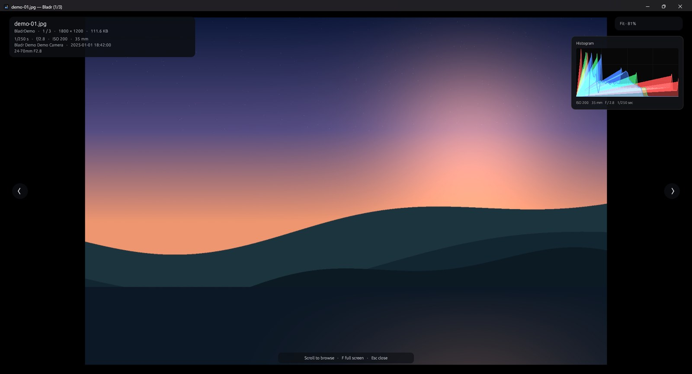
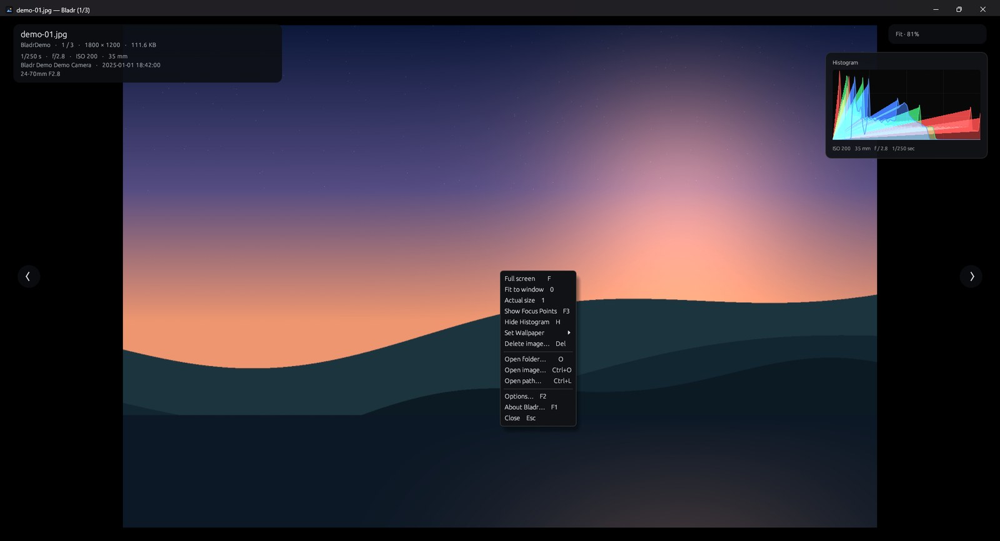
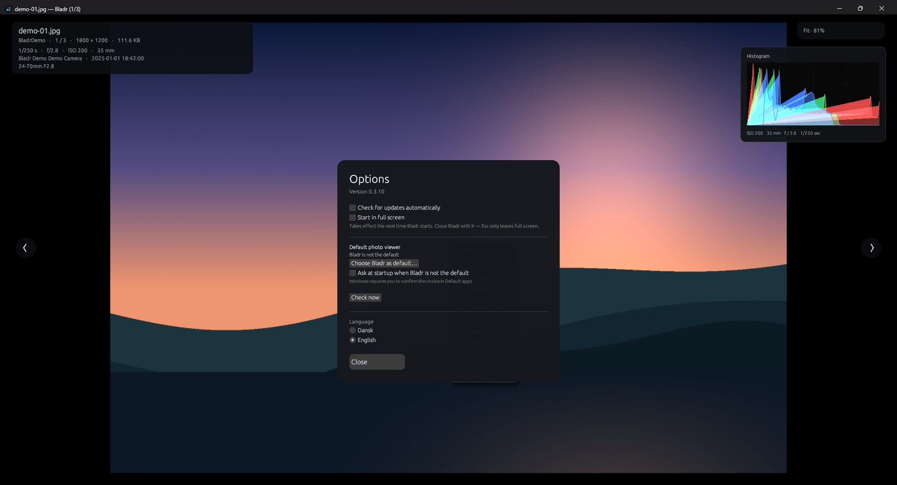
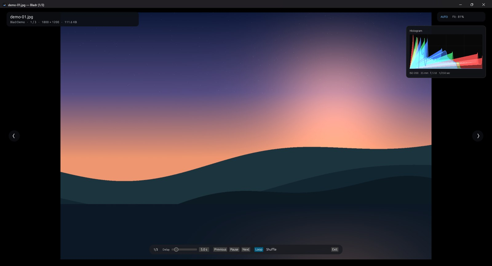

# Bladr

A small, fast image viewer for Windows, written in Rust. It follows the way
ACDSee Photo Studio Ultimate works in View mode: point it at a folder, scroll
the mouse wheel to flip through images, and press `F` for full screen.

Bladr is an independent program and contains no code from ACDSee.

[Dansk version](README.da.md)

[](https://buymeacoffee.com/jonathannet)

## Screenshots



| Context menu | Options |
| --- | --- |
|  |  |



## Download

There are two options under **Releases** on GitHub:

- **`Bladr-0.3.11-Setup.exe`** — Windows installer.
- **`Bladr.exe`** — portable single file that can be copied anywhere.

### Installation

Run `Bladr-0.3.11-Setup.exe`. It installs **per user** and requires **no
administrator rights**. It creates:

- A Start-menu shortcut and an optional desktop shortcut.
- **“Open with Bladr”** in the right-click menu for folders (including
  UNC/NAS folders).
- A Bladr entry in Windows' **“Open with”** list without changing defaults.

Uninstall via **Settings → Apps → Installed apps → Bladr**.

The file is not code-signed, so Windows SmartScreen may warn the first time:
choose **More info → Run anyway**.

## Language

Bladr starts in the **Windows display language**: Danish on a Danish system,
English otherwise. Change it with **`Alt+L`** or in **Options** (`F2`); the
choice is saved in `%APPDATA%\Bladr\language.txt`.

- `BLADR_LANG=en` or `BLADR_LANG=da` forces a language at startup.
- Add a language as a table in [`src/i18n.rs`](src/i18n.rs); missing keys fall
  back to English.

## Features

- **Mouse wheel** moves to the next/previous image in the current folder, and
  wraps around at the ends.
- **Full screen** with `F`, `F11` or a double-click. `Esc` or right-click
  leaves full screen.
- **Fit / 100 %** with `0` and `1`; zoom with `+`/`-` or `Ctrl` + wheel. Drag
  the image to pan when it is larger than the window.
- **Slideshow** with the space bar (changes every 3.2 seconds).
- **EXIF orientation** is honoured, so portrait shots do not open sideways.
- **Prefetching** of neighbours and a background decoder keep browsing
  responsive. The previous image stays on screen until the next one is ready.
- **HUD** with filename, folder, counter, dimensions, file size and zoom. It
  fades in on activity and disappears after a few seconds.
- **EXIF overlay** with shutter speed, aperture, ISO, focal length, camera and
  date. Toggle it with `I`; the HUD stays visible while it is open.
- **RGB histogram** overlay in the top-right corner; toggle it with `H`.
- **Focus points** overlay for Canon CR3: **right-click → Show Focus Points**.
  Reads Canon's AFInfo2 record and draws the selected AF area over the image.
- **Set Wallpaper** submenu: Centered, Tiled, Stretched and Restore. RAW files
  are converted to a temporary PNG before Windows uses them.
- **Slideshow bar** with delay, previous/next, pause/play, loop and shuffle.
  Start with `Space`, leave full screen with `Esc`, or press **Exit** on the bar.
  The HUD and bar hide when the mouse is still and return when it moves.
- **Delete image** with `Del`: a confirmation dialog moves the file to the
  Recycle Bin and then shows the next image. On network drives, where there is
  no Recycle Bin, the file is deleted permanently after confirmation. If
  Windows requires administrator rights, Bladr asks for UAC and deletes through
  a temporary administrator helper.
- **Show file location:** right-click → **Show file location** opens Explorer
  with the current file selected.
- **Drag & drop** of a file or folder, plus `O` (folder) and `Ctrl+O` (file).
- **Single instance:** opening another image from Explorer reuses the running
  Bladr window instead of starting a second copy.
- Remembers the last folder in `%APPDATA%\Bladr\last_folder.txt`.
- Starts **maximised**, and has an **About** dialog (`F1` or the right-click
  menu) showing the version.
- **Options** dialog (`F2`) with **automatic update** on/off, **start in full
  screen**, **default photo viewer**, manual “Check now”, and language
  selection.
- **Default photo viewer:** Bladr registers itself with Windows. If it is not
  the default, it asks at startup; “No, don’t ask again” suppresses the prompt,
  and it can be enabled again under **Default photo viewer** in Options.
- **Automatic updates:** checks GitHub Releases at most every six hours,
  downloads the installer and starts it. Turn it off in Options. The setting is
  stored in `%APPDATA%\Bladr\settings.txt`.
- Supported formats: JPEG, PNG, GIF, BMP, WebP, TIFF, ICO, TGA, DDS, HDR,
  PNM, QOI and Farbfeld — plus RAW through the camera's embedded JPEG preview
  (CR3, NEF, CR2, ARW, DNG, ORF, RW2, RAF and more).
- **Windows icon and version information** are embedded in the exe itself, so
  Explorer, Task Manager and the taskbar show the Bladr icon.

## Controls

| Action | Shortcut |
| --- | --- |
| Next / previous image | Wheel down / up, `→` / `←`, `PageDown` / `PageUp` |
| First / last | `Home` / `End` |
| Full screen | `F`, `F11`, double-click |
| Leave full screen | `Esc`, right-click |
| Fit to window | `0` |
| Actual size (100 %) | `1` |
| Zoom in / out | `+` / `-`, `Ctrl` + wheel |
| Pan | Drag with the mouse (when zoomed in) |
| Slideshow | `Space` |
| Slideshow delay / loop / shuffle | Controls on the slideshow bar |
| Delete image | `Del` |
| Show file location | Right-click → Show file location |
| Set wallpaper | Right-click → Set Wallpaper |
| Show EXIF info / keep HUD | `I` |
| Show/hide RGB histogram | `H` |
| Show/hide focus points | Right-click → Show Focus Points, `F3` |
| Switch language (Danish/English) | `Alt+L` |
| Options | `F2` |
| About dialog | `F1` or right-click → About Bladr… |
| Menu (full screen, zoom, open, close) | Right-click in windowed mode |
| Open folder / file | `O` / `Ctrl+O` |
| Open path or network folder | `Ctrl+L` |
| Close | `Esc` (in windowed mode) |

One wheel notch equals one image. Touchpad gestures are accumulated, so a
short gesture also moves exactly one image.

## Network and NAS

Network paths can be typed directly with `Ctrl+L` — for example:

```text
\\192.168.1.221\foto
Y:\foto
```

The folder is scanned in the background, so the window does not freeze while a
NAS responds. “Opening network folder…” is shown, and the scan can be
cancelled.

If Windows rejects the path, Bladr shows the exact error (for example
`Access is denied (os error 5)`) and a suggestion. Bladr cannot ask for network
credentials itself: open the share in Explorer first, or map it to a drive with
“Reconnect at sign-in”. Bladr then inherits that access.

Bladr only reads images directly in the selected folder — not in subfolders.

## RAW (CR3, NEF, DNG, ARW …)

Bladr displays RAW files in two ways:

1. **Linear DNG** with an unpacked RGB layer is decoded directly at full
   resolution. This is the kind of DNG Adobe Camera Raw and Lightroom often
   export.
2. **Camera RAW** (CFA data) and JPEG-compressed DNGs are shown through the
   JPEG preview the camera wrote into the file.

This gives instant display without a full RAW pipeline and without libraw.

- Nikon NEF: usually full resolution (tested 5568 × 3712).
- Canon CR3: usually full resolution on newer cameras (tested 6960 × 4640).
- DNG (linear): full resolution directly from the RGB layer (tested 5184 × 3456).
- DNG with a **Deflate- or LZW-compressed** RGB layer is also supported; this is
  the variant some DxO exports use.
- DNG with **JPEG-compressed tiles or a full-size preview** is supported
  (tested 5568 × 3712 from DxO). The preview JPEG is used when the RAW tiles are
  lossless JPEG, which cannot be decoded.
- DNG with **JPEG XL compression** (DNG 1.7, typically DxO PureRAW) cannot be
  decoded yet. Export the DNG without compression, or as TIFF/JPEG.
- Containers: CR3, CR2, NEF, NRW, ARW, DNG, ORF, RW2, RAF, PEF, SRW and more.
- **No** demosaicing, colour profile or exposure correction is performed — this
  is the camera preview or the DNG's finished RGB layer, not a RAW converter.
- If a file has neither a usable RGB layer nor a JPEG preview, an error message
  is shown.
- The HUD shows `RAW` before the dimensions, so the source is identifiable.

## TIF/TIFF

TIF and TIFF are supported directly, including 8-bit LZW/Deflate and 16-bit
RGB (tested 1600 × 1000 and 800 × 600). Multi-page TIFF files show the first
page; there is no page navigation in this version.

## Build

Requires Rust (MSVC toolchain on Windows).

```powershell
cargo build --release
```

The icon and version information are embedded with the Windows SDK's `rc.exe`,
which `build.rs` locates automatically. Without `rc.exe` the program still
builds — just without a file icon. A specific compiler can be selected with the
`RC_EXE` environment variable.

The finished exe is `target\release\bladr.exe`. It can be copied freely and
does not require ACDSee or any other installation. Windows may cache old icons;
press `F5` in Explorer if the icon looks wrong after an update.

### Installer

The installer is built with **Inno Setup 6**:

```powershell
winget install JRSoftware.InnoSetup
& "$env:LOCALAPPDATA\Programs\Inno Setup 6\ISCC.exe" installer\bladr.iss
cargo build --release --manifest-path installer\launcher\Cargo.toml
```

Copy `installer\launcher\target\release\bladr-setup-launcher.exe` to
`installer\Output\Bladr-<version>-Setup.exe` after the inner setup has been
compiled as `Bladr-<version>-Setup-inner.exe`. The small launcher gives Inno a
writable temp folder under `%LOCALAPPDATA%\Bladr\Setup`, which avoids the
“unable to create the directory …is-*.tmp” error on locked-down machines.

GitHub Actions builds and uploads both the exe and the installer automatically
on a version tag.

## Architecture

- `src/main.rs` — CLI, window setup and icon.
- `src/library.rs` — folder scanning, supported file types and natural sorting
  (`img2` before `img10`).
- `src/decode.rs` — one background thread decodes and downscales to max 4096 px,
  applies EXIF orientation and drops stale requests.
- `src/app.rs` — egui/eframe UI, wheel handling, full screen, HUD, zoom/pan,
  Options/About dialogs and texture cache.
- `src/i18n.rs` — Danish/English strings with English fallback.
- `src/settings.rs` — persisted options (`%APPDATA%\Bladr\settings.txt`).
- `src/update.rs` — GitHub release check and installer download via WinHTTP.

## Branches

- `main` — stable releases.
- `dev` — testing. Pushes build test artifacts but do not publish a GitHub
  release. Merge `dev` into `main` and push a `v*` tag when a build is stable.

## Limitations

- HEIC/HEIF and video are not supported; those need platform codecs.
- RAW is shown as the camera's JPEG preview, not a full demosaic.
- DNG with JPEG XL compression (DxO PureRAW) is not supported.
- Focus-point overlay is currently limited to Canon CR3; DxO DNG exports strip
  the camera maker notes that contain focus points.
- Animated GIF/WebP show the first frame.
- There is no catalogue database, metadata editor or non-destructive editing —
  it is a viewer, not an ACDSee replacement.
- Folders are not scanned recursively; only images directly in the selected
  folder.

## Support

If Bladr is useful to you, you can support its development with a coffee:

[Buy Me a Coffee →](https://buymeacoffee.com/jonathannet)

## License

MIT.
